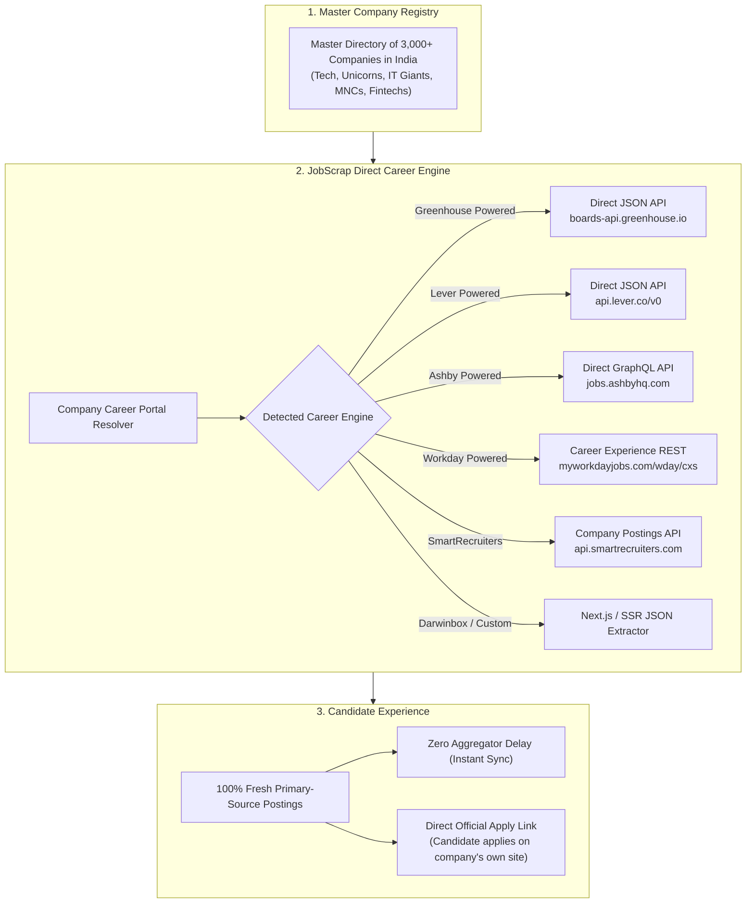
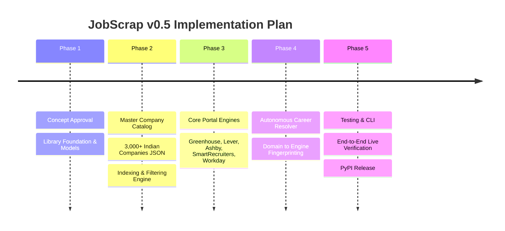

# Elephant-Goldfish Model (EGM) Concept Brief & Architectural Blueprint
## Project: JobScrap v0.5 — Master Indian Company Direct-Career & ATS Aggregation Library

**Document Version:** 2.0.0-APPROVED  
**Lifecycle Stage:** EGM Phase 1 (Brainstorm & Concept Brief — Direct Company Architecture)  
**Target Release:** v0.5.0-alpha  
**Author:** Antigravity Architect & Engineering Lead  
**Review Status:** Updated with User Feedback  

---

## 1. Executive Summary & Strategic Mission

### 1.1 The Core Problem: Third-Party Aggregator Decay
Job aggregators (Naukri, Indeed, LinkedIn, etc.) have fundamental flaws for both candidates and automated systems:
1. **The 3-to-7 Day Stale Window**: When a company publishes a job on its official career portal, aggregators take days to scrape or syndicate it. By the time candidates find it on job boards, hundreds of applicants have already applied, or the job is already closed.
2. **Aggregator Redirection & Affiliate Traps**: Board links bounce candidates through login walls, affiliate trackers, or dead redirect loops (`?expJD=true`, expired viewjob pages).
3. **Missing Direct Application Forms**: Aggregators often lack the exact questions, resume submission endpoints, or hiring manager details found on the company's official site.

### 1.2 The v0.5 Paradigm: Direct-to-Company Career Ingestion
In **v0.5**, `jobscrap` shifts from a "job board scraper" to a **Direct Company Career Aggregation Engine & Open-Source Library**:
- **Master Indian Company Registry**: Pre-loaded with **3,000 to 5,000+ companies operating across India** (tech startups, unicorns, Indian IT services giants, global MNC tech hubs, fintechs, and GCCs).
- **Official Career Portal Extraction**: Directly probes and pulls jobs straight from each company's official career portal (e.g., `careers.swiggy.com`, `careers.zomato.com`, `razorpay.com/jobs`).
- **Under-the-Hood Secret (Why This Works at Scale)**:
  Companies do *not* build custom career backends from scratch. 98% of Indian and global enterprises embed standard Applicant Tracking System (ATS) engines (**Greenhouse, Lever, Ashby, SmartRecruiters, Workday CX, Darwinbox, Taleo**) behind their official career pages.
  By targeting the standard JSON APIs that power these company career portals, **one unified engine can seamlessly ingest thousands of company career sites** without writing fragile, breaking HTML scrapers for each website!
- **100% Direct Application Links**: The candidate receives the official company application URL. When they click apply, they land directly on the company's own official hiring form with zero middlemen.



---

## 2. Master Indian Company Directory Strategy

### 2.1 Target Sectors & Initial Cohorts (3,000+ Companies)
The registry classifies companies operating across India into structured tiers:

1. **Tier 1: Indian Tech Unicorns & Fast-Growing Startups (500+ Companies)**:
   - *Examples*: Swiggy, Zomato, Razorpay, CRED, Zepto, Meesho, Groww, Zerodha, PhonePe, Urban Company, Nykaa, Lenskart, Ather Energy.
   - *Primary Engines*: Greenhouse, Lever, Ashby.
2. **Tier 2: Global MNC Capability Centers (GCCs) & Tech Hubs (1,000+ Companies)**:
   - *Examples*: Google India, Microsoft India, Amazon India, Uber, Atlassian, Adobe, Cisco, Intuit, Salesforce, Goldman Sachs, Morgan Stanley (Bangalore/Hyderabad/Pune).
   - *Primary Engines*: Workday CX, Greenhouse, SmartRecruiters, Taleo.
3. **Tier 3: IT Services & Enterprise Giants (500+ Companies)**:
   - *Examples*: TCS, Infosys, Wipro, HCL Technologies, Tech Mahindra, Cognizant, LTIMindtree, Persistent Systems.
   - *Primary Engines*: Workday, Oracle Taleo, iCIMS, SuccessFactors.
4. **Tier 4: Banking, Financial Services & Insurance (BFSI) (500+ Companies)**:
   - *Examples*: HDFC Bank, ICICI Bank, Axis Bank, Kotak, Bajaj Finserv, Navi, Jupiter, Fi Money.
   - *Primary Engines*: Darwinbox, SmartRecruiters, Workday.
5. **Tier 5: Core Engineering, Manufacturing & Consumer (500+ Companies)**:
   - *Examples*: Tata Motors, Reliance Jio, Larsen & Toubro, ITC, Titan, Mahindra.

### 2.2 Company Metadata Schema (`company_catalog.json`)
```json
{
  "id": "comp_razorpay",
  "name": "Razorpay",
  "domain": "razorpay.com",
  "careers_url": "https://razorpay.com/jobs",
  "hq_location": "Bengaluru, India",
  "industry": "Fintech / Payments",
  "tier": 1,
  "ats_type": "greenhouse",
  "ats_identifier": "razorpay",
  "api_endpoint": "https://boards-api.greenhouse.io/v1/boards/razorpay/jobs?content=true",
  "active_job_count": 84,
  "last_synced_at": "2026-11-23T10:00:00Z"
}
```

---

## 3. Library Architecture & Directory Structure

The library is organized so that developers can use it either to scrape specific companies, search by job role across all companies, or add new companies dynamically.

```
jobscrap/
├── __init__.py                # Public library exports: JobScraper, CompanyCatalog, DirectPortal
├── py.typed                   # PEP 561 static typing marker
├── core/                      # Runtime essentials
│   ├── config.py              # Timeouts, concurrency limits, proxy configurations
│   ├── models.py              # JobListing, CompanyProfile, SalaryRange
│   ├── session.py             # Resilient HTTP session with TLS impersonation
│   └── exceptions.py          # Unified exception hierarchy
├── catalog/                   # Master Indian Company Directory
│   ├── __init__.py
│   ├── registry.py            # Fast in-memory indexed query engine for companies
│   ├── companies.json         # Embedded directory of 3,000+ Indian tech & corporate employers
│   └── updater.py             # Automatic background updater for company catalog
├── engines/                   # Official Career Portal Engines (Underlying ATS)
│   ├── __init__.py
│   ├── base.py                # BaseCareerEngine abstract class
│   ├── greenhouse.py          # Greenhouse Board JSON API
│   ├── lever.py               # Lever Postings v0 JSON API
│   ├── ashby.py               # AshbyHQ GraphQL API
│   ├── workday.py             # Workday Career Experience (CX) REST client
│   ├── smartrecruiters.py     # SmartRecruiters Postings API
│   ├── bamboohr.py            # BambooHR Public Ingestion
│   └── generic_ssr.py         # Fallback Next.js / Nuxt / JSON-LD structured data parser
├── discovery/                 # Autonomous Resolver for Uncataloged Companies
│   ├── __init__.py
│   ├── resolver.py            # Company domain -> Career page URL finder
│   └── detector.py            # HTML / Network signature classifier (detects underlying engine)
├── pipeline/                  # Normalization & Enrichment
│   ├── __init__.py
│   ├── salary.py              # Multi-currency & Indian Lakhs/LPA normalizer
│   ├── experience.py          # Experience classifier (Fresher, 0-2y, 3-5y, Lead)
│   └── dedup.py               # Token Jaccard deduplication
├── storage/                   # Storage backends
│   ├── sqlite.py              # Canonical local SQLite storage (WAL mode)
│   ├── jsonl.py               # Streaming JSONL file exporter
│   └── memory.py              # Fast in-memory Python list / DataFrame
└── cli/                       # Command-line interface
    └── main.py                # Modern CLI tool (jobscrap company, jobscrap search)
```

---

## 4. Developer API & Usage Examples

### 4.1 Search by Role Across All 3,000+ Companies
```python
import asyncio
from jobscrap import JobScraper

async def main():
    # Initializes scraper pre-loaded with the Indian company catalog
    scraper = JobScraper()
    
    # Searches directly across company career portals for matching openings
    jobs = await scraper.search_companies(
        query="Software Engineer",
        locations=["Bengaluru", "Hyderabad", "Remote"],
        min_experience_years=0,  # Fresher friendly
        limit=50
    )

    for job in jobs:
        print(f"🏢 {job.company} | 💼 {job.title}")
        print(f"📍 {job.location} | 💰 {job.salary or 'Competitive'}")
        print(f"🔗 Direct Apply: {job.url}\n")

asyncio.run(main())
```

### 4.2 Ingest All Live Jobs from a Specific Company
```python
from jobscrap import CompanyCatalog

catalog = CompanyCatalog()

# Instant direct fetch from official company portal
swiggy_jobs = catalog.get_company("Swiggy").fetch_jobs()
print(f"Fetched {len(swiggy_jobs)} live jobs directly from Swiggy's official portal!")
```

### 4.3 Autonomous Resolution of Any New Company
```python
from jobscrap import DirectPortal

# Even if a company is NOT in our catalog, give its domain or name:
portal = DirectPortal.from_domain("zepto.com")
print(f"Detected Career Engine: {portal.engine_name}")  # Output: ashby
jobs = portal.fetch_jobs()
```

---

## 5. Elephant Deep-Context Trade-Off Analysis

| Dimension | Legacy Board Scraping (v0.4) | Direct-Company Portal Pipeline (v0.5) |
|---|---|---|
| **Data Freshness** | Lagging (3 to 7 days behind official release) | **Real-Time (Zero-second lag; fetched the second HR publishes)** |
| **Link Integrity** | 80-90% (Subject to soft-404s, affiliate redirects) | **100% Genuine Direct Apply Links on company's own site** |
| **Application Flow** | Bounces through third-party logins & aggregators | **Candidate applies directly on company's official HR system** |
| **Maintenance Burden** | High (Aggregators actively fight scrapers with CAPTCHAs) | **Extremely Low (Company career APIs are public by design)** |
| **Coverage** | Broad, but full of duplicate and expired postings | **Focused, verified, and high-signal corporate jobs** |

---

## 6. Implementation Milestones



1. **Milestone 1: Library Scaffolding & Canonical Schema**:
   Set up `jobscrap/core/`, typing, and canonical `JobListing` dataclasses.
2. **Milestone 2: Master Indian Company Directory Seed**:
   Compile and embed the curated dataset of 3,000+ top employers in India (`catalog/companies.json`).
3. **Milestone 3: Underlying Career Engines**:
   Build high-speed, zero-headless JSON clients for Greenhouse, Lever, Ashby, SmartRecruiters, and Workday CX.
4. **Milestone 4: Autonomous Discovery Module**:
   Build the crawler that takes any unlisted company website (e.g. `cred.club`) and automatically discovers its careers portal and underlying engine.
5. **Milestone 5: Verification Suite & Documentation**:
   Full integration tests with live companies, CLI tools (`jobscrap company "Zomato"`), and documentation.

---

## 7. Open Decisions for Implementation

1. **Catalog Auto-Update**: Should the library include an automatic background sync that refreshes the 3,000-company catalog from an open GitHub raw JSON feed so users always have up-to-date company endpoints?
2. **Hybrid Fallback Flag**: When a user searches for a very rare keyword that no cataloged company has open, should `jobscrap` optionally fall back to our existing public board scrapers (Naukri/Indeed) via a `--fallback-boards` flag?
